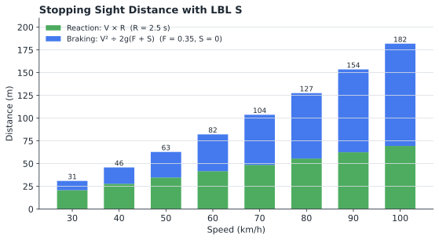
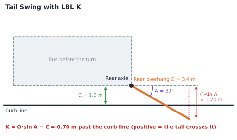
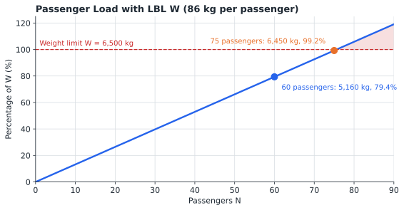

# safedrive Statefile

## TABLE OF CONTENTS

1. [Introduction](#1-introduction)
2. [Theory of Operations](#2-theory-of-operations)
3. [Variable Definitions](#3-variable-definitions)
4. [Program Descriptions](#4-program-descriptions)
5. [Operating Instructions](#5-operating-instructions)
6. [Example Calculations](#6-example-calculations)
7. [Quick Reference](#7-quick-reference)
8. [Program Listing](#8-program-listing)

---

## 1. INTRODUCTION

This program suite provides transit safety and planning calculations for the SwissMicros DM32 calculator. It solves braking problems from speed and any one known value, calculates stopping sight distance, checks a bus's tail swing past the curb and its passenger load against a weight limit, and finds the number of buses a route requires.

### 1.1 Purpose

The program enables operators, trainers, and planners to:

- Find the stopping distance, time, and deceleration for a bus braking from any speed
- Express stopping distance in 40 ft bus lengths
- Calculate stopping sight distance, including reaction time, road friction, and grade
- Check whether the rear overhang will swing past the curb in a turn
- Compare a passenger load with a weight limit
- Calculate the number of buses needed for a route and headway

### 1.2 System Requirements

SwissMicros DM32 calculator with RPN operating system. Program requires 136 program steps in 10 labels. Flag 1 adds a display of the stopping distance in bus lengths.

The program uses only functions found on the HP-32SII. It needs about 228 bytes of program memory plus 8 bytes for each variable in use, so it can be keyed into an HP-32SII from the listing in section 8; use CLEAR VARS if memory runs short.

### 1.3 Install and Download

Copy **SAFEDRIVE.d32** to the `/STATE` folder of the DM32's internal USB disk, then load it from the calculator. Instructions are available [via the DM32 User Manual](https://technical.swissmicros.com/dm32/doc/dm32_user_manual.html#_saving_and_loading_a_state).

---

## 2. THEORY OF OPERATIONS


### 2.1 Braking to a Stop

A vehicle braking at a constant deceleration X from speed V traces a straight line on a speed-time graph, falling to zero at time T. The four braking values are tied together by that one triangle:

```
T = V ÷ X                 Time to stop, s
D = V × T ÷ 2             Stopping distance, m (the area under the line)
X = V² ÷ (2 × D)          Deceleration, m/s²
G = X ÷ 9.80665           Deceleration in g
```


Each braking program (LBL G, D, T, and X) prompts for the speed in km/h, which LBL V converts to m/s, then for the one value it is named after, and calculates the other three. LBL Z displays all four.

A deceleration of about 0.25 g is typical for a transit bus braking normally, and about 0.29 g is generally considered the top end of acceptable braking for a bus carrying passengers. Stopping distance grows with the square of the speed: doubling the speed quadruples the distance.


### 2.2 Bus Lengths

With Flag 1 set, LBL Z also displays the stopping distance divided by 12.192 m, the length of a 40 ft bus. This expresses the distance in a unit that is easy to picture from the driver's seat.

### 2.3 Stopping Sight Distance

Stopping sight distance is the distance travelled from the moment a hazard is seen until the vehicle stops. It adds the distance covered during the driver's reaction time to the braking distance:

```
Reaction distance = V × R
Braking distance  = V² ÷ (2 × g × (F + S))
Total             = reaction distance + braking distance
```

Where R is the reaction time (s), F is the coefficient of friction between tire and road, and S is the grade as a decimal (+0.05 for a 5% uphill grade, −0.05 for 5% downhill). A downhill grade lengthens the braking distance.



### 2.4 Tail Swing

When a bus turns away from the curb, its rear overhang (the body behind the rear axle) swings out toward the curb. LBL K compares that swing with the distance from the side of the bus to the curb:

```
K = O × sin(A) − C
```

Where O is the rear overhang, A is the angle of turn, and C is the distance from the curb. A positive result is how far the tail swings past the curb line; a negative result is the clearance that remains.



### 2.5 Passenger Load

LBL W multiplies the number of passengers by 86 kg and expresses the result as a percentage of a weight limit W, such as the bus's rated payload.



### 2.6 Buses Required

The number of buses needed to run a route is the time each bus takes to complete one cycle divided by the headway:

```
Buses = (P + L) ÷ H
```

Where P is the paddle (running) time, L is the layover, and H is the headway, all in minutes. A fractional result is rounded up to the next whole bus.


---

## 3. VARIABLE DEFINITIONS

| Variable | Description |
|----------|-------------|
| **V** | Speed, km/h |
| **M** | Speed, m/s (internal use) |
| **U** | Standard gravity, 9.80665 m/s² (internal use) |
| **G** | Deceleration, g |
| **X** | Deceleration, m/s²; reaction distance in LBL S |
| **T** | Time to stop, s |
| **D** | Stopping distance, m |
| **B** | Stopping distance in 40 ft bus lengths |
| **R** | Reaction time, s |
| **F** | Coefficient of friction |
| **S** | Grade, decimal (+ uphill, − downhill) |
| **Y** | Braking distance in LBL S, m |
| **Z** | Stopping sight distance in LBL S, m |
| **A** | Angle of turn, degrees |
| **C** | Distance from the curb, m |
| **O** | Rear overhang, m |
| **W** | Weight limit, kg |
| **N** | Number of passengers |
| **P** | Paddle (running) time, minutes |
| **L** | Layover, minutes |
| **H** | Headway, minutes |

---

## 4. PROGRAM DESCRIPTIONS

### 4.1 Braking Programs

Each prompts for speed (V?, km/h) and then one known value:

| Label | Known value | Prompt | Units |
|-------|-------------|--------|-------|
| **G** | Deceleration in g | G? | g |
| **D** | Stopping distance | D? | m |
| **T** | Time to stop | T? | s |
| **X** | Deceleration | X? | m/s² |

**Outputs (Stack display from top to bottom):**
- T: Deceleration, g
- Z: Deceleration, m/s²
- Y: Time to stop, s
- X: Stopping distance, m
- With Flag 1 set, the distance in bus lengths is displayed first (VIEW B); press `[R/S]` to continue

### 4.2 LBL S - Stopping Sight Distance

**Inputs:** Speed (V?, km/h), reaction time (R?, s), coefficient of friction (F?), grade (S?, decimal)

**Outputs (Stack display from top to bottom):**
- Z: Reaction distance, m
- Y: Braking distance, m
- X: Total stopping sight distance, m

### 4.3 LBL K - Tail Swing

**Inputs:** Angle of turn (A?, degrees), distance from the curb (C?, m), rear overhang (O?, m)

**Output:** Tail swing past the curb line in the X register, m (negative = clearance remaining)

### 4.4 LBL W - Passenger Load

**Inputs:** Weight limit (W?, kg), number of passengers (N?)

**Outputs:**
- Y: Load as a percentage of W
- X: Passenger load, kg

### 4.5 LBL B - Buses Required

**Inputs:** Paddle time (P?, minutes), layover (L?, minutes), headway (H?, minutes)

**Output:** Buses required in the X register (round up to the next whole bus)

### 4.6 Internal Subroutines

- **LBL V:** Prompts for speed and converts km/h to m/s
- **LBL Z:** Calculates bus lengths and displays the braking results

---

## 5. OPERATING INSTRUCTIONS

### 5.1 Braking

**Procedure:**
```
1. Press [XEQ] and G, D, T, or X
2. Enter the speed in km/h at the V? prompt and press [R/S]
3. Enter the known value at the second prompt and press [R/S]
```

To also see the distance in bus lengths, press `[SF] [1]` first. Flag 1 stays set until cleared with `[CF] [1]`.

### 5.2 Stopping Sight Distance

**Procedure:**
```
1. Press [XEQ] [S]
2. V? speed, km/h                      [R/S]
3. R? reaction time, s                 [R/S]
4. F? coefficient of friction          [R/S]
5. S? grade, decimal (+ up, - down)    [R/S]
```

### 5.3 Tail Swing

**Procedure:**
```
1. Press [XEQ] [K]
2. A? angle of turn, degrees           [R/S]
3. C? distance from the curb, m        [R/S]
4. O? rear overhang, m                 [R/S]
```

### 5.4 Passenger Load

**Procedure:**
```
1. Press [XEQ] [W]
2. W? weight limit, kg                 [R/S]
3. N? number of passengers             [R/S]
```

### 5.5 Buses Required

**Procedure:**
```
1. Press [XEQ] [B]
2. P? paddle time, minutes             [R/S]
3. L? layover, minutes                 [R/S]
4. H? headway, minutes                 [R/S]
```

Each prompt shows the value used last time; press `[R/S]` to keep it.

---

## 6. EXAMPLE CALCULATIONS

Results are shown in FIX 6, the display format saved in the Statefile.

### 6.1 Normal Braking

**Problem:** A bus brakes from 50 km/h at 0.25 g. How far and how long does it take to stop?

**Solution:**
```
[SF] [1]
[XEQ] [G]
V?  50   [R/S]
G?  0.25 [R/S]
B=3.226780   [R/S]
```

**Results (displayed on screen from top to bottom):**

| Register | Value | Meaning |
|----------|-------|---------|
| T | 0.250000 | Deceleration, g |
| Z | 2.451663 | Deceleration, m/s² |
| Y | 5.665090 | Time to stop, s |
| X | 39.340903 | Stopping distance, m |

**Interpretation:** The bus stops in 39.3 m, about 3.2 bus lengths, taking 5.7 seconds.

### 6.2 Stopping in a Set Distance

**Problem:** A hazard appears 30 m ahead of a bus travelling at 50 km/h. What deceleration is needed to stop in time?

**Solution:**
```
[XEQ] [D]
V?  50 [R/S]
D?  30 [R/S]
```

**Results:**

| Register | Value | Meaning |
|----------|-------|---------|
| T | 0.327841 | Deceleration, g |
| Z | 3.215021 | Deceleration, m/s² |
| Y | 4.320000 | Time to stop, s |
| X | 30.000000 | Stopping distance, m |

**Interpretation:** Stopping in 30 m needs 0.33 g, beyond the 0.29 g generally considered the top end of acceptable braking for a bus carrying passengers.

### 6.3 Stopping in a Set Time

**Problem:** A bus at 50 km/h stops in 5 seconds. What is the deceleration?

**Solution:**
```
[XEQ] [T]
V?  50 [R/S]
T?  5  [R/S]
```

**Results:**

| Register | Value | Meaning |
|----------|-------|---------|
| T | 0.283255 | Deceleration, g |
| Z | 2.777778 | Deceleration, m/s² |
| Y | 5.000000 | Time to stop, s |
| X | 34.722222 | Stopping distance, m |

### 6.4 Braking at a Measured Deceleration

**Problem:** An accelerometer records 2.45 m/s² while a bus brakes from 50 km/h.

**Solution:**
```
[XEQ] [X]
V?  50   [R/S]
X?  2.45 [R/S]
```

**Results:**

| Register | Value | Meaning |
|----------|-------|---------|
| T | 0.249830 | Deceleration, g |
| Z | 2.450000 | Deceleration, m/s² |
| Y | 5.668934 | Time to stop, s |
| X | 39.367599 | Stopping distance, m |

### 6.5 Stopping Sight Distance on a Downgrade

**Problem:** A bus travels at 50 km/h down a 5% grade. With a reaction time of 2.5 s and a friction coefficient of 0.35, how much sight distance does the driver need?

**Solution:**
```
[XEQ] [S]
V?  50         [R/S]
R?  2.5        [R/S]
F?  0.35       [R/S]
S?  0.05 [+/-] [R/S]
```

**Results:**

| Register | Value | Meaning |
|----------|-------|---------|
| Z | 34.722222 | Reaction distance, m |
| Y | 32.784086 | Braking distance, m |
| X | 67.506308 | Total stopping sight distance, m |

**Interpretation:** On level ground the total would be 62.8 m; the downgrade adds 4.7 m of braking distance.

### 6.6 Tail Swing

**Problem:** A bus with a 3.4 m rear overhang, 1.0 m from the curb, turns through 30°. Does the tail cross the curb line?

**Solution:**
```
[XEQ] [K]
A?  30  [R/S]
C?  1   [R/S]
O?  3.4 [R/S]
```

**Expected Result:** 0.700000. The tail swings 0.7 m past the curb line. At a 15° turn the result is −0.120015: 0.12 m of clearance remains.

### 6.7 Passenger Load

**Problem:** A bus has a 6,500 kg weight limit and carries 60 passengers.

**Solution:**
```
[XEQ] [W]
W?  6500 [R/S]
N?  60   [R/S]
```

**Results:**

| Register | Value | Meaning |
|----------|-------|---------|
| Y | 79.384615 | Percentage of the weight limit |
| X | 5,160.000000 | Passenger load, kg |

### 6.8 Buses Required

**Problem:** A route has a 60-minute paddle time and a 10-minute layover. How many buses are needed for a 15-minute headway?

**Solution:**
```
[XEQ] [B]
P?  60 [R/S]
L?  10 [R/S]
H?  15 [R/S]
```

**Expected Result:** 4.666667, so 5 buses are required.

---

## 7. QUICK REFERENCE

### 7.1 Program Summary

| Label | Function | Prompts | Output |
|-------|----------|---------|--------|
| **G** | Braking from g | V, G | T: g, Z: m/s², Y: s, X: m |
| **D** | Braking from distance | V, D | As G |
| **T** | Braking from time | V, T | As G |
| **X** | Braking from m/s² | V, X | As G |
| **S** | Stopping sight distance | V, R, F, S | Z: reaction, Y: braking, X: total |
| **K** | Tail swing | A, C, O | X: past the curb (+) or clearance (−) |
| **W** | Passenger load | W, N | Y: %, X: kg |
| **B** | Buses required | P, L, H | X: buses |

### 7.2 Reference Values

| Value | Typical |
|-------|---------|
| Normal service braking | 0.25 g (2.45 m/s²) |
| Top end of acceptable braking | 0.29 g (2.84 m/s²) |
| Bus length used for B | 12.192 m (40 ft) |
| Passenger mass used by LBL W | 86 kg |

### 7.3 Important Notes

- Speed is entered in km/h; all distances are in metres
- Grade is entered as a decimal: +0.05 uphill, −0.05 downhill
- The angle of turn in LBL K is in degrees; the Statefile is saved in DEG mode
- Round the result of LBL B up to the next whole bus
- The braking programs assume a constant deceleration from the moment the brakes are applied; LBL S adds the driver's reaction time

---

## 8. PROGRAM LISTING

The complete program listing is provided below. Program steps are shown in standard DM32 RPN format with label-relative line numbers, as displayed on the calculator. The DM32 does not generate checksums.

### LBL G - Braking from g-Force

```
G01  LBL G    Braking from deceleration in g.
G02  XEQ V    Prompts for speed.
G03  INPUT G  Prompts for g-force.
G04  RCL U
G05  ×        Deceleration, m/s².
G06  STO X    Stored in X.
G07  ÷        Time to stop, V ÷ X.
G08  STO T    Stored in T.
G09  RCL M
G10  RCL× T
G11  2
G12  ÷        Distance, V × T ÷ 2.
G13  STO D    Stored in D.
G14  GTO Z    Displays results.
```

### LBL D - Braking from Stopping Distance

```
D01  LBL D    Braking from stopping distance.
D02  XEQ V    Prompts for speed.
D03  INPUT D  Prompts for distance, m.
D04  RCL M
D05  x²
D06  RCL÷ D
D07  2
D08  ÷        Deceleration, V² ÷ 2D.
D09  STO X    Stored in X.
D10  RCL÷ U   In g.
D11  STO G    Stored in G.
D12  2
D13  RCL× D
D14  RCL÷ M   Time, 2D ÷ V.
D15  STO T    Stored in T.
D16  GTO Z    Displays results.
```

### LBL T - Braking from Stopping Time

```
T01  LBL T    Braking from stopping time.
T02  XEQ V    Prompts for speed.
T03  INPUT T  Prompts for time, s.
T04  RCL× U
T05  1/x
T06  ×        g-force, V ÷ (T × g).
T07  STO G    Stored in G.
T08  RCL× U   Deceleration, m/s².
T09  STO X    Stored in X.
T10  RCL M
T11  RCL× T
T12  2
T13  ÷        Distance, V × T ÷ 2.
T14  STO D    Stored in D.
T15  GTO Z    Displays results.
```

### LBL X - Braking from Deceleration

```
X01  LBL X    Braking from deceleration in m/s².
X02  XEQ V    Prompts for speed.
X03  INPUT X  Prompts for deceleration.
X04  ÷        Time, V ÷ X.
X05  STO T    Stored in T.
X06  RCL M
X07  RCL× T
X08  2
X09  ÷        Distance, V × T ÷ 2.
X10  STO D    Stored in D.
X11  RCL X
X12  RCL÷ U   g-force.
X13  STO G    Stored in G.
X14  GTO Z    Displays results.
```

### LBL V - Speed Input

```
V01  LBL V    Speed input.
V02  INPUT V  Prompts for speed, km/h.
V03  3.6
V04  ÷        km/h to m/s.
V05  STO M    Stored in M.
V06  9.80665  Standard gravity, m/s².
V07  STO U    Stored in U.
V08  x<>y
V09  RTN      Returns speed in X.
```

### LBL Z - Results Display

```
Z01  LBL Z    Results display.
Z02  RCL D
Z03  12.192
Z04  ÷        Distance ÷ 12.192 m.
Z05  STO B    Bus lengths, B.
Z06  RCL G    T-register: g-force.
Z07  RCL X    Z-register: m/s².
Z08  RCL T    Y-register: time, s.
Z09  RCL D    X-register: distance, m.
Z10  FS? 1    Flag 1 set?
Z11  VIEW B   Then views bus lengths.
Z12  RTN
```

### LBL S - Stopping Sight Distance

```
S01  LBL S    Stopping sight distance.
S02  XEQ V    Prompts for speed.
S03  INPUT R  Prompts for reaction time, s.
S04  INPUT F  Prompts for friction coefficient.
S05  INPUT S  Prompts for grade (+ up, − down).
S06  RCL M
S07  RCL× R   Reaction distance, V × R.
S08  STO X    Stored in X.
S09  RCL M
S10  x²
S11  2
S12  RCL× U
S13  RCL F
S14  RCL+ S
S15  ×
S16  ÷        Braking, V² ÷ 2g(F + S).
S17  +        Total distance.
S18  STO Z    Stored in Z.
S19  x<>y
S20  -        Total − reaction = braking.
S21  STO Y    Stored in Y.
S22  CLx      Clears stack.
S23  ENTER
S24  RCL X    Z-register: reaction distance.
S25  RCL Y    Y-register: braking distance.
S26  RCL Z    X-register: total.
S27  RTN
```

### LBL K - Tail Swing

```
K01  LBL K    Tail swing.
K02  INPUT A  Prompts for turn angle.
K03  INPUT C  Prompts for distance from curb.
K04  INPUT O  Prompts for rear overhang.
K05  RCL A
K06  SIN
K07  RCL× O   O × sin A.
K08  RCL- C   − C: past the curb if positive.
K09  RTN
```

### LBL W - Passenger Load

```
W01  LBL W    Passenger load.
W02  INPUT W  Prompts for weight limit, kg.
W03  INPUT N  Prompts for passengers.
W04  86
W05  ×        Load at 86 kg each.
W06  ENTER
W07  x<>y
W08  RCL÷ W
W09  100
W10  ×        Percentage of W.
W11  x<>y     X: load, Y: percentage.
W12  RTN
```

### LBL B - Buses Required

```
B01  LBL B    Buses required.
B02  INPUT P  Prompts for paddle time.
B03  INPUT L  Prompts for layover.
B04  INPUT H  Prompts for headway.
B05  RCL P
B06  RCL+ L   Paddle + layover.
B07  RCL÷ H   ÷ headway = buses.
B08  RTN
```

---

## Disclaimer

This program suite is provided as-is for educational and planning purposes. It does not replace agency procedures, vehicle specifications, or professional training, and its results should not be relied on as the sole basis for operational or safety decisions.

### By jacober-calc for SwissMicros DM32

> - [SwissMicros Website](https://www.swissmicros.com)
> - [DM32 product page](https://www.swissmicros.com/en/products/dm32)
> - [SwissMicros full products page](https://www.swissmicros.com/en/shop)
> - [DM32 Online User Manual](https://technical.swissmicros.com/dm32/doc/dm32_user_manual.html)
> - [SwissMicros Calculator Forum](https://forum.swissmicros.com/index.php)
