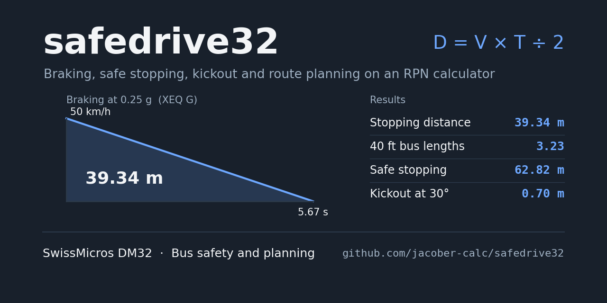
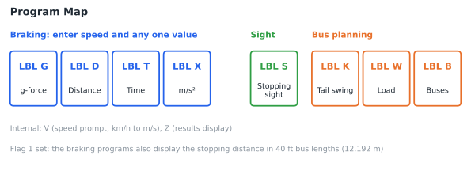
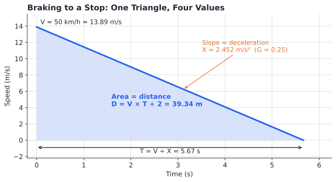
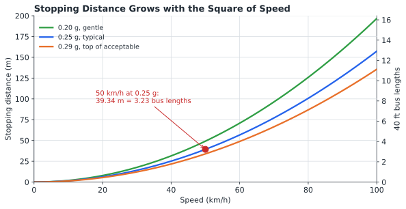
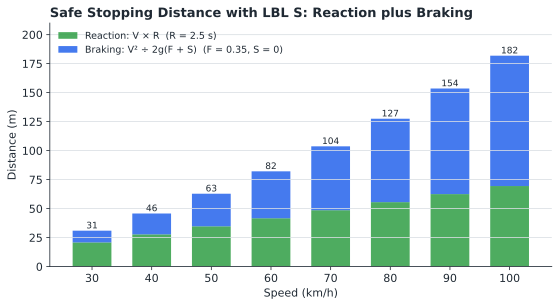
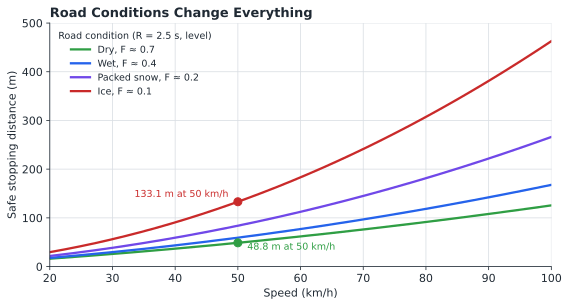
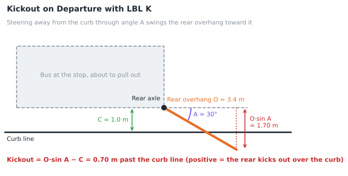
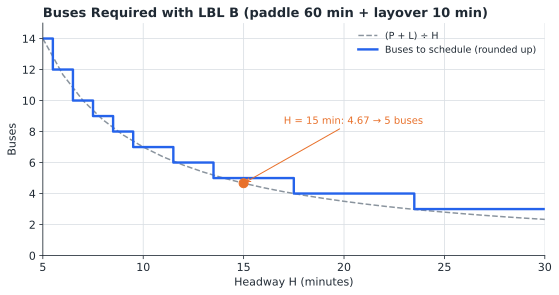
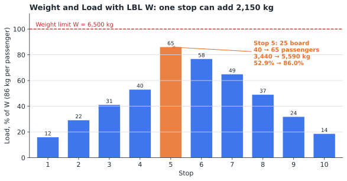

# safedrive Statefile

## CONTENTS

1. [Introduction](#1-introduction)
2. [Disclaimer](#2-disclaimer)
3. [Theory of Operations](#3-theory-of-operations)
4. [Variable Definitions](#4-variable-definitions)
5. [Program Descriptions](#5-program-descriptions)
6. [Operating Instructions](#6-operating-instructions)
7. [Example Calculations](#7-example-calculations)
8. [Quick Reference](#8-quick-reference)
9. [Program Listing](#9-program-listing)

---

## 1. INTRODUCTION

This program suite provides bus safety and route planning calculations for the SwissMicros DM32 calculator. The safety programs solve braking problems, calculate the safe stopping distance of a vehicle for its speed, the driver's reaction time, the road conditions and the slope, and determine how far a bus's rear overhang kicks out over the curb as it departs a stop. The planning programs calculate the number of buses a route requires and the weight a passenger load places on a bus.

### 1.1 Purpose

The program enables operators, trainers, and planners to:

- Find the stopping distance, time, and deceleration of a bus braking from any speed, starting from any one known value
- Express a stopping distance in 40 ft bus lengths
- Calculate a safe stopping distance using the standard reaction-plus-braking method, including road conditions and slope
- Determine how far the rear of a bus kicks out over the curb when it departs a stop
- Determine whether a route has enough buses for its headway, and the headway a smaller fleet can actually run
- Calculate the weight of a passenger load against a weight limit, and see how quickly it changes at a single stop

### 1.2 Program Groups

| Group | Labels | Purpose |
|-------|--------|---------|
| **Safety** | G, D, T, X | Braking: stopping distance, time, and deceleration |
| **Safety** | S | Safe stopping distance |
| **Safety** | K | Kickout on departure |
| **Planning** | B | Buses required, or headway for a fleet |
| **Planning** | W | Weight and load |

### 1.3 System Requirements

SwissMicros DM32 calculator with RPN operating system. Program requires 136 program steps in 10 labels. Flag 1 adds a display of the stopping distance in bus lengths.

The program uses only functions found on the HP-32SII. It needs about 228 bytes of program memory plus 8 bytes for each variable in use, so it can be keyed into an HP-32SII from the listing in section 9; use CLEAR VARS if memory runs short.

### 1.4 Install and Download

Copy **SAFEDRIVE.d32** to the `/STATE` folder of the DM32's internal USB disk, then load it from the calculator. Instructions are available [via the DM32 User Manual](https://technical.swissmicros.com/dm32/doc/dm32_user_manual.html#_saving_and_loading_a_state).

---

## 2. DISCLAIMER

### IMPORTANT NOTICE

This program suite is provided for educational and planning purposes. Its results are idealized: they assume a constant deceleration, a single coefficient of friction, and the inputs entered by the user. It does not replace agency procedures, vehicle specifications, professional driver training, or the judgement of the operator. The developer (jacober-calc) makes no warranties, express or implied, regarding the accuracy, completeness, or suitability of this program for any particular purpose, and its results must not be relied on as the sole basis for operational or safety decisions.

---

## 3. THEORY OF OPERATIONS



### 3.1 Braking to a Stop

A bus braking at a constant deceleration from speed V traces a straight line on a speed-time graph, falling to zero at time T. The stopping distance is the area under that line. Four values describe the stop, and any one of them, together with the speed, fixes the other three.

#### Key Equations

```
T = V ÷ X                 Time to stop, s
D = V × T ÷ 2             Stopping distance, m
X = V² ÷ (2 × D)          Deceleration, m/s²
G = X ÷ 9.80665           Deceleration, g
B = D ÷ 12.192            Stopping distance, 40 ft bus lengths
```

Where V is the speed in m/s. The programs prompt for speed in km/h; LBL V divides by 3.6.



#### Deceleration and Passenger Comfort

A deceleration of about 0.25 g (2.45 m/s²) is typical of normal service braking for a transit bus, and about 0.29 g (2.84 m/s²) is generally considered the top end of acceptable braking for a bus carrying passengers. Stopping distance grows with the square of the speed: doubling the speed quadruples the distance.



### 3.2 Safe Stopping Distance

The braking programs measure the stop from the moment the brakes are applied. A safe stopping distance must also include the distance travelled while the driver perceives a hazard and reacts. LBL S uses the standard method used in road design (the stopping sight distance of the AASHTO *Green Book*), which adds the two:

#### Key Equations

```
Reaction distance  = V × R
Braking distance   = V² ÷ (2 × g × (F + S))
Safe stopping      = Reaction distance + Braking distance
```

Where:
- **R** is the perception-reaction time in seconds (2.5 s is the standard design value)
- **F** is the coefficient of friction between tire and road, which reflects the road conditions
- **S** is the slope (grade) as a decimal: +0.05 for a 5% uphill grade, −0.05 for 5% downhill

At low speeds the reaction distance dominates; at high speeds the braking distance does.



#### Road Conditions and Slope

The coefficient of friction falls sharply on wet, snowy, or icy roads, and a downhill slope reduces the braking force available. Both lengthen the braking distance, while the reaction distance stays the same. The values below are approximate and vary with tires and road surface:

| Road condition | Approximate F |
|----------------|---------------|
| Dry pavement | 0.7 |
| Wet pavement | 0.4 |
| Packed snow | 0.2 |
| Ice | 0.1 |



### 3.3 Kickout

A bus pivots about its rear axle when it turns. As it departs a stop and steers away from the curb, the rear overhang (the body behind the rear axle) swings the other way, toward and over the curb. Anyone standing at the curb edge is in the path of this kickout.

#### Key Equation

```
Kickout = O × sin(A) − C
```

Where O is the rear overhang, A is the angle of turn, and C is the distance from the side of the bus to the curb. A positive result is how far the rear kicks out over the curb line; a negative result is the clearance that remains.



### 3.4 Buses Required

Each bus on a route takes the paddle (running) time plus the layover to complete one cycle. To provide a bus every headway minutes, the route needs:

#### Key Equation

```
Buses = (P + L) ÷ H
```

Where P is the paddle time, L is the layover, and H is the headway, all in minutes. A fractional result is rounded up to the next whole bus.

The same equation answers the reverse question. Entering the number of buses available at the H? prompt returns the headway that fleet can actually run. When the fleet is short, the headway lengthens and each bus picks up the passengers of a longer interval, so the buses run fuller.



### 3.5 Weight and Load

LBL W converts a passenger count into a weight at 86 kg per passenger and expresses it as a percentage of a weight limit W, such as the bus's rated payload.

#### Key Equations

```
Load       = N × 86 kg
Percentage = Load ÷ W × 100
```

Loads change quickly. A single busy stop can add tens of passengers and more than two tonnes, and a short fleet (section 3.4) raises every load on the route.



### 3.6 Program Logic Flow

**Braking programs (G, D, T, X):**
1. LBL V prompts for speed in km/h, converts it to m/s, and stores g
2. The program prompts for its one known value
3. The remaining three braking values are calculated
4. LBL Z calculates bus lengths, displays them if Flag 1 is set, and places the results on the stack

**Safe stopping distance (S):**
1. LBL V prompts for speed
2. The program prompts for reaction time, coefficient of friction, and slope
3. Reaction, braking, and total distances are calculated and placed on the stack

---

## 4. VARIABLE DEFINITIONS

| Variable | Description |
|----------|-------------|
| **V** | Speed, km/h |
| **M** | Speed, m/s (internal use) |
| **U** | Standard gravity, 9.80665 m/s² (internal use) |
| **G** | Deceleration, g |
| **X** | Deceleration, m/s²; reaction distance in LBL S |
| **T** | Time to stop, s |
| **D** | Stopping distance, m |
| **B** | Stopping distance, 40 ft bus lengths |
| **R** | Perception-reaction time, s |
| **F** | Coefficient of friction (road conditions) |
| **S** | Slope (grade), decimal: + uphill, − downhill |
| **Y** | Braking distance in LBL S, m |
| **Z** | Safe stopping distance in LBL S, m |
| **A** | Angle of turn, degrees |
| **C** | Distance from the curb, m |
| **O** | Rear overhang, m |
| **P** | Paddle time, minutes |
| **L** | Layover, minutes |
| **H** | Headway, minutes (or number of buses available) |
| **W** | Weight limit, kg |
| **N** | Number of passengers |

---

## 5. PROGRAM DESCRIPTIONS

### 5.1 LBL G, D, T, X - Braking

Calculates a stop from the speed and any one known braking value.

| Label | Known value | Prompt |
|-------|-------------|--------|
| **G** | Deceleration, g | G? |
| **D** | Stopping distance, m | D? |
| **T** | Time to stop, s | T? |
| **X** | Deceleration, m/s² | X? |

**Inputs:** V (Speed, km/h), then the known value

**Outputs (Stack display from top to bottom):**
- T: Deceleration, g
- Z: Deceleration, m/s²
- Y: Time to stop, s
- X: Stopping distance, m

With Flag 1 set, the stopping distance in bus lengths is displayed first (`B=`); press `R/S` to continue.

### 5.2 LBL S - Safe Stopping Distance

Calculates the safe stopping distance for the speed, the driver's reaction time, the road conditions, and the slope.

**Inputs:** V (Speed, km/h), R (Reaction time, s), F (Coefficient of friction), S (Slope, decimal)

**Outputs (Stack display from top to bottom):**
- Z: Reaction distance, m
- Y: Braking distance, m
- X: Safe stopping distance, m

### 5.3 LBL K - Kickout

Calculates how far the rear of a bus kicks out over the curb as it departs a stop.

**Inputs:** A (Angle of turn, degrees), C (Distance from the curb, m), O (Rear overhang, m)

**Output:** Kickout over the curb line, m (X register). A negative result is the clearance remaining.

### 5.4 LBL B - Buses Required

Calculates the number of buses a route requires for a headway, or the headway a fleet can run.

**Inputs:** P (Paddle time, minutes), L (Layover, minutes), H (Headway, minutes, or number of buses available)

**Output:** Buses required (X register; round up), or headway in minutes if the number of buses was entered at H?

### 5.5 LBL W - Weight and Load

Calculates the weight of a passenger load and compares it with a weight limit.

**Inputs:** W (Weight limit, kg), N (Number of passengers)

**Outputs (Stack display from top to bottom):**
- Y: Load, percentage of W
- X: Load, kg

### 5.6 Internal Subroutines

- **LBL V:** Prompts for speed, converts km/h to m/s, and stores g (9.80665 m/s²)
- **LBL Z:** Calculates bus lengths and displays the braking results

---

## 6. OPERATING INSTRUCTIONS

Every program prompts for its inputs. Each prompt shows the value used last time; press `R/S` to keep it, or key in a new value and press `R/S`.

### 6.1 Braking (LBL G, D, T, X)

**Procedure:**

1. To display bus lengths, press `SF 1` (optional; Flag 1 stays set until `CF 1`)
2. Press `XEQ G`, `XEQ D`, `XEQ T`, or `XEQ X`
3. Enter the speed when prompted (V?)
4. Enter the known value when prompted (G?, D?, T?, or X?)
5. If Flag 1 is set, bus lengths are displayed; press `R/S`

**The program will display (from top to bottom on screen):**
- T-register: Deceleration, g
- Z-register: Deceleration, m/s²
- Y-register: Time to stop, s
- X-register: Stopping distance, m

### 6.2 Safe Stopping Distance (LBL S)

**Procedure:**

1. Press `XEQ S`
2. Enter the speed when prompted (V?)
3. Enter the reaction time when prompted (R?)
4. Enter the coefficient of friction when prompted (F?)
5. Enter the slope as a decimal when prompted (S?); use `+/-` for downhill

**The program will display (from top to bottom on screen):**
- Z-register: Reaction distance, m
- Y-register: Braking distance, m
- X-register: Safe stopping distance, m

### 6.3 Kickout (LBL K)

**Procedure:**

1. Press `XEQ K`
2. Enter the angle of turn when prompted (A?)
3. Enter the distance from the curb when prompted (C?)
4. Enter the rear overhang when prompted (O?)

The kickout is displayed in the X-register.

### 6.4 Buses Required (LBL B)

**Procedure:**

1. Press `XEQ B`
2. Enter the paddle time when prompted (P?)
3. Enter the layover when prompted (L?)
4. Enter the headway when prompted (H?), or the number of buses available to find the headway

The result is displayed in the X-register.

### 6.5 Weight and Load (LBL W)

**Procedure:**

1. Press `XEQ W`
2. Enter the weight limit when prompted (W?)
3. Enter the number of passengers when prompted (N?)

**The program will display (from top to bottom on screen):**
- Y-register: Load, percentage of W
- X-register: Load, kg

---

## 7. EXAMPLE CALCULATIONS

Results are shown in FIX 6, the display format saved in the Statefile.

### 7.1 Normal Service Braking

**Scenario:**

A bus travelling at 50 km/h brakes at 0.25 g, a typical service stop. Find the stopping distance in metres and in bus lengths, and the time taken.

**Solution:**

Press: `SF 1`, then `XEQ G`

| Prompt | Enter | Description |
|--------|-------|-------------|
| V? | 50 | Speed, km/h |
| G? | 0.25 | Deceleration, g |

The display shows `B=3.226780`. Press `R/S`.

**Results (displayed on screen from top to bottom):**

| Register | Value | Meaning |
|----------|-------|---------|
| T | 0.250000 | Deceleration, g |
| Z | 2.451663 | Deceleration, m/s² |
| Y | 5.665090 | Time to stop, s |
| X | 39.340903 | Stopping distance, m |

**Interpretation:**

The bus needs 39.3 m, about 3.2 bus lengths, and 5.7 seconds to stop from the moment the brakes are applied.

### 7.2 Stopping in a Set Distance

**Scenario:**

A hazard appears 30 m ahead of a bus travelling at 50 km/h. What deceleration does the bus need to stop in time?

**Solution:**

Press: `XEQ D`

| Prompt | Enter | Description |
|--------|-------|-------------|
| V? | 50 | Speed, km/h |
| D? | 30 | Stopping distance, m |

**Results (displayed on screen from top to bottom):**

| Register | Value | Meaning |
|----------|-------|---------|
| T | 0.327841 | Deceleration, g |
| Z | 3.215021 | Deceleration, m/s² |
| Y | 4.320000 | Time to stop, s |
| X | 30.000000 | Stopping distance, m |

**Interpretation:**

Stopping in 30 m needs 0.33 g, beyond the 0.29 g generally considered the top end of acceptable braking for a bus carrying passengers.

### 7.3 Stopping in a Set Time

**Scenario:**

A bus at 50 km/h stops in 5 seconds. Find the deceleration and distance.

**Solution:**

Press: `XEQ T`

| Prompt | Enter | Description |
|--------|-------|-------------|
| V? | 50 | Speed, km/h |
| T? | 5 | Time to stop, s |

**Results (displayed on screen from top to bottom):**

| Register | Value | Meaning |
|----------|-------|---------|
| T | 0.283255 | Deceleration, g |
| Z | 2.777778 | Deceleration, m/s² |
| Y | 5.000000 | Time to stop, s |
| X | 34.722222 | Stopping distance, m |

**Interpretation:**

A 5-second stop from 50 km/h is a firm stop at 0.28 g, just inside the acceptable range.

### 7.4 Braking at a Measured Deceleration

**Scenario:**

An accelerometer records 2.45 m/s² while a bus brakes from 50 km/h.

**Solution:**

Press: `XEQ X`

| Prompt | Enter | Description |
|--------|-------|-------------|
| V? | 50 | Speed, km/h |
| X? | 2.45 | Deceleration, m/s² |

**Results (displayed on screen from top to bottom):**

| Register | Value | Meaning |
|----------|-------|---------|
| T | 0.249830 | Deceleration, g |
| Z | 2.450000 | Deceleration, m/s² |
| Y | 5.668934 | Time to stop, s |
| X | 39.367599 | Stopping distance, m |

**Interpretation:**

The measured stop matches normal service braking of 0.25 g.

### 7.5 Safe Stopping Distance

**Scenario:**

A bus travels at 50 km/h on a level road. Using the standard design reaction time of 2.5 s and a coefficient of friction of 0.35, find the safe stopping distance.

**Solution:**

Press: `XEQ S`

| Prompt | Enter | Description |
|--------|-------|-------------|
| V? | 50 | Speed, km/h |
| R? | 2.5 | Reaction time, s |
| F? | 0.35 | Coefficient of friction |
| S? | 0 | Slope, level |

**Results (displayed on screen from top to bottom):**

| Register | Value | Meaning |
|----------|-------|---------|
| Z | 34.722222 | Reaction distance, m |
| Y | 28.100645 | Braking distance, m |
| X | 62.822867 | Safe stopping distance, m |

**Interpretation:**

More than half of the safe stopping distance is covered before the brakes are applied. The bus travels 34.7 m while the driver perceives and reacts, then 28.1 m while braking.

### 7.6 Road Conditions and Slope

**Scenario:**

The same bus travels at 50 km/h on packed snow (F = 0.2) down a 5% slope.

**Solution:**

Press: `XEQ S`

| Prompt | Enter | Description |
|--------|-------|-------------|
| V? | 50 | Speed, km/h |
| R? | 2.5 | Reaction time, s |
| F? | 0.2 | Coefficient of friction, packed snow |
| S? | 0.05 `+/-` | Slope, 5% downhill |

**Results (displayed on screen from top to bottom):**

| Register | Value | Meaning |
|----------|-------|---------|
| Z | 34.722222 | Reaction distance, m |
| Y | 65.568172 | Braking distance, m |
| X | 100.290394 | Safe stopping distance, m |

**Interpretation:**

The reaction distance is unchanged, but the braking distance more than doubles, and the safe stopping distance rises from 62.8 m to 100.3 m. The driver needs over 100 m of clear road ahead.

### 7.7 Kickout on Departure

**Scenario:**

A bus with a 3.4 m rear overhang is stopped 1.0 m from the curb. It departs with a 30° angle of turn. How far does the rear kick out over the curb?

**Solution:**

Press: `XEQ K`

| Prompt | Enter | Description |
|--------|-------|-------------|
| A? | 30 | Angle of turn, degrees |
| C? | 1 | Distance from the curb, m |
| O? | 3.4 | Rear overhang, m |

**Results:**

| Register | Value | Meaning |
|----------|-------|---------|
| X | 0.700000 | Kickout over the curb line, m |

**Interpretation:**

The rear of the bus sweeps 0.7 m over the curb, through the space where waiting passengers stand. With a 15° angle of turn the result is −0.120015: the rear stays 0.12 m clear of the curb line.

### 7.8 Buses Required

**Scenario:**

A route has a 60-minute paddle time and a 10-minute layover. How many buses are needed to provide a 15-minute headway?

**Solution:**

Press: `XEQ B`

| Prompt | Enter | Description |
|--------|-------|-------------|
| P? | 60 | Paddle time, minutes |
| L? | 10 | Layover, minutes |
| H? | 15 | Headway, minutes |

**Results:**

| Register | Value | Meaning |
|----------|-------|---------|
| X | 4.666667 | Buses required |

**Interpretation:**

The route needs 5 buses. With only 4, the 15-minute headway cannot be kept (section 7.9).

### 7.9 Headway for a Short Fleet

**Scenario:**

Only 4 buses are available for the same route. What headway can they run?

**Solution:**

Press: `XEQ B`, press `R/S` to keep P? and L?, then:

| Prompt | Enter | Description |
|--------|-------|-------------|
| H? | 4 | Number of buses available |

**Results:**

| Register | Value | Meaning |
|----------|-------|---------|
| X | 17.500000 | Headway, minutes |

**Interpretation:**

Four buses can run a 17.5-minute headway. Each bus now collects 17.5 ÷ 15 = 1.17 times as many passengers, so a stop that would board 60 passengers per bus now boards 70 (section 7.11).

### 7.10 Load Change at a Single Stop

**Scenario:**

A bus with a 6,500 kg weight limit arrives at a busy stop carrying 40 passengers and leaves with 65.

**Solution:**

Press: `XEQ W`

| Prompt | Enter | Description |
|--------|-------|-------------|
| W? | 6500 | Weight limit, kg |
| N? | 40 | Passengers on arrival |

Then press `XEQ W`, `R/S` to keep W?, and:

| Prompt | Enter | Description |
|--------|-------|-------------|
| N? | 65 | Passengers on departure |

**Results:**

| Passengers | Y: Percentage of W | X: Load, kg |
|------------|--------------------|-------------|
| 40 | 52.923077 | 3,440.000000 |
| 65 | 86.000000 | 5,590.000000 |

**Interpretation:**

In one stop the load rises by 2,150 kg, from about half of the weight limit to 86%.

### 7.11 Load with a Short Fleet

**Scenario:**

With the 4-bus fleet of section 7.9, a bus that would carry 60 passengers carries 70. Check the load.

**Solution:**

Press: `XEQ W`

| Prompt | Enter | Description |
|--------|-------|-------------|
| W? | 6500 | Weight limit, kg |
| N? | 70 | Passengers |

**Results (displayed on screen from top to bottom):**

| Register | Value | Meaning |
|----------|-------|---------|
| Y | 92.615385 | Load, percentage of W |
| X | 6,020.000000 | Load, kg |

**Interpretation:**

The missing bus raises the load from 79.4% (60 passengers) to 92.6% of the weight limit, leaving little margin for the next busy stop.

---

## 8. QUICK REFERENCE

### 8.1 Program Labels

| Label | Group | Function | Prompts |
|-------|-------|----------|---------|
| **G** | Safety | Braking from g-force | V, G |
| **D** | Safety | Braking from stopping distance | V, D |
| **T** | Safety | Braking from time to stop | V, T |
| **X** | Safety | Braking from deceleration | V, X |
| **S** | Safety | Safe stopping distance | V, R, F, S |
| **K** | Safety | Kickout on departure | A, C, O |
| **B** | Planning | Buses required, or headway | P, L, H |
| **W** | Planning | Weight and load | W, N |
| **V, Z** | Internal | Speed input, braking display | |

### 8.2 Typical Input Ranges

| Variable | Typical Range |
|----------|---------------|
| **V** | 10 to 100 km/h |
| **G** | 0.15 to 0.29 g (service braking) |
| **R** | 1.5 to 2.5 s (2.5 s standard design value) |
| **F** | 0.1 (ice) to 0.7 (dry pavement) |
| **S** | −0.08 to +0.08 |
| **A** | 0 to 45° |
| **O** | 2.5 to 4.0 m (40 ft bus) |
| **H** | 5 to 30 minutes |

### 8.3 Important Notes

- Speed is entered in km/h; all distances are in metres
- The braking programs measure from the moment the brakes are applied; use LBL S to include the driver's reaction time
- Enter slope as a decimal: +0.05 uphill, −0.05 downhill
- The angle of turn in LBL K is in degrees; the Statefile is saved in DEG mode
- A positive kickout means the rear crosses the curb line
- Round the result of LBL B up to the next whole bus
- Enter the number of buses at the H? prompt of LBL B to find the headway a fleet can run
- LBL W uses 86 kg per passenger

---

## 9. PROGRAM LISTING

The complete program listing is provided below. Program steps are shown in standard DM32 RPN format with label-relative line numbers, as displayed on the calculator. The DM32 does not generate checksums.

### LBL G - Braking from g-Force

```
G01  LBL G    Braking from deceleration in g.
G02  XEQ V    Prompts for speed.
G03  INPUT G  Prompts for g-force.
G04  RCL U
G05  ×        Deceleration, m/s².
G06  STO X    Stored in X.
G07  ÷        Time to stop, V ÷ X.
G08  STO T    Stored in T.
G09  RCL M
G10  RCL× T
G11  2
G12  ÷        Distance, V × T ÷ 2.
G13  STO D    Stored in D.
G14  GTO Z    Displays results.
```

### LBL D - Braking from Stopping Distance

```
D01  LBL D    Braking from stopping distance.
D02  XEQ V    Prompts for speed.
D03  INPUT D  Prompts for distance, m.
D04  RCL M
D05  x²
D06  RCL÷ D
D07  2
D08  ÷        Deceleration, V² ÷ 2D.
D09  STO X    Stored in X.
D10  RCL÷ U   In g.
D11  STO G    Stored in G.
D12  2
D13  RCL× D
D14  RCL÷ M   Time, 2D ÷ V.
D15  STO T    Stored in T.
D16  GTO Z    Displays results.
```

### LBL T - Braking from Stopping Time

```
T01  LBL T    Braking from stopping time.
T02  XEQ V    Prompts for speed.
T03  INPUT T  Prompts for time, s.
T04  RCL× U
T05  1/x
T06  ×        g-force, V ÷ (T × g).
T07  STO G    Stored in G.
T08  RCL× U   Deceleration, m/s².
T09  STO X    Stored in X.
T10  RCL M
T11  RCL× T
T12  2
T13  ÷        Distance, V × T ÷ 2.
T14  STO D    Stored in D.
T15  GTO Z    Displays results.
```

### LBL X - Braking from Deceleration

```
X01  LBL X    Braking from deceleration in m/s².
X02  XEQ V    Prompts for speed.
X03  INPUT X  Prompts for deceleration.
X04  ÷        Time, V ÷ X.
X05  STO T    Stored in T.
X06  RCL M
X07  RCL× T
X08  2
X09  ÷        Distance, V × T ÷ 2.
X10  STO D    Stored in D.
X11  RCL X
X12  RCL÷ U   g-force.
X13  STO G    Stored in G.
X14  GTO Z    Displays results.
```

### LBL V - Speed Input Subroutine

```
V01  LBL V    Speed input.
V02  INPUT V  Prompts for speed, km/h.
V03  3.6
V04  ÷        km/h to m/s.
V05  STO M    Stored in M.
V06  9.80665  Standard gravity, m/s².
V07  STO U    Stored in U.
V08  x<>y
V09  RTN      Returns speed in X.
```

### LBL Z - Braking Results Display

```
Z01  LBL Z    Results display.
Z02  RCL D
Z03  12.192
Z04  ÷        Distance ÷ 12.192 m.
Z05  STO B    Bus lengths, B.
Z06  RCL G    T-register: g-force.
Z07  RCL X    Z-register: m/s².
Z08  RCL T    Y-register: time, s.
Z09  RCL D    X-register: distance, m.
Z10  FS? 1    Flag 1 set?
Z11  VIEW B   Then views bus lengths.
Z12  RTN
```

### LBL S - Safe Stopping Distance

```
S01  LBL S    Safe stopping distance.
S02  XEQ V    Prompts for speed.
S03  INPUT R  Prompts for reaction time, s.
S04  INPUT F  Prompts for friction coefficient.
S05  INPUT S  Prompts for grade (+ up, − down).
S06  RCL M
S07  RCL× R   Reaction distance, V × R.
S08  STO X    Stored in X.
S09  RCL M
S10  x²
S11  2
S12  RCL× U
S13  RCL F
S14  RCL+ S
S15  ×
S16  ÷        Braking, V² ÷ 2g(F + S).
S17  +        Total distance.
S18  STO Z    Stored in Z.
S19  x<>y
S20  -        Total − reaction = braking.
S21  STO Y    Stored in Y.
S22  CLx      Clears stack.
S23  ENTER
S24  RCL X    Z-register: reaction distance.
S25  RCL Y    Y-register: braking distance.
S26  RCL Z    X-register: safe stopping distance.
S27  RTN
```

### LBL K - Kickout

```
K01  LBL K    Kickout on departure.
K02  INPUT A  Prompts for angle of turn.
K03  INPUT C  Prompts for distance from curb.
K04  INPUT O  Prompts for rear overhang.
K05  RCL A
K06  SIN
K07  RCL× O   O × sin A.
K08  RCL- C   − C: over the curb if positive.
K09  RTN
```

### LBL W - Weight and Load

```
W01  LBL W    Weight and load.
W02  INPUT W  Prompts for weight limit, kg.
W03  INPUT N  Prompts for passengers.
W04  86
W05  ×        Load at 86 kg each.
W06  ENTER
W07  x<>y
W08  RCL÷ W
W09  100
W10  ×        Percentage of W.
W11  x<>y     X: load, Y: percentage.
W12  RTN
```

### LBL B - Buses Required

```
B01  LBL B    Buses required (or headway).
B02  INPUT P  Prompts for paddle time.
B03  INPUT L  Prompts for layover.
B04  INPUT H  Prompts for headway.
B05  RCL P
B06  RCL+ L   Paddle + layover.
B07  RCL÷ H   ÷ H: buses (or headway if H = buses).
B08  RTN
```

---

### By jacober-calc for SwissMicros DM32

> - [SwissMicros Website](https://www.swissmicros.com)
> - [DM32 product page](https://www.swissmicros.com/en/products/dm32)
> - [SwissMicros full products page](https://www.swissmicros.com/en/shop)
> - [DM32 Online User Manual](https://technical.swissmicros.com/dm32/doc/dm32_user_manual.html)
> - [SwissMicros Calculator Forum](https://forum.swissmicros.com/index.php)
